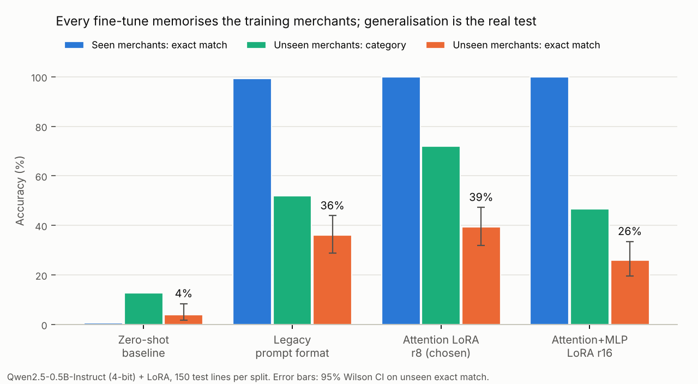

# Edge spending categoriser

**Fine-tuning a 0.5B language model to read messy bank statements on-device, and finding out how well it really generalises.**

```
"CONTACTLESS GREGGS 1823 MANCHESTER £2.56"  →  {"merchant": "Greggs", "amount": 2.56, "category": "eating_out"}
```

Everything runs on one Apple Silicon (Arm) MacBook Air: QLoRA fine-tuning with MLX, GGUF export and
quantisation with llama.cpp, CPU inference benchmarks with llama-cpp-python, and every run tracked in MLflow.

---

## TL;DR

- **Fine-tuning works on the format.** Valid JSON goes from 41% zero-shot to 100%, and amounts are extracted correctly 100% of the time, including line formats never seen in training.
- **Generalising to new merchants is the hard part.** Every fine-tuned model scores ~100% on merchants it trained on, but the best gets **39% exact match** (72% category) on merchants it has never seen.
- **Fewer trainable parameters generalised better.** Attention-only LoRA (1.1M parameters) beat attention+MLP LoRA (8.8M): 39% vs 26%, McNemar p = 0.003.



---

## Goal

Spending categorisation is useful, but bank statements are sensitive. The goal is a model **small enough to
run on the user's own device**, so the data never leaves it, that turns raw statement lines into structured JSON:
merchant name, amount and one of eight categories (`groceries`, `transport`, `eating_out`, `bills`,
`subscriptions`, `shopping`, `entertainment`, `cash`).

## Hypotheses

| # | Hypothesis | Result |
|---|---|---|
| H1 | LoRA fine-tuning makes a 0.5B model produce reliable structured output | **Supported.** Valid JSON 41% → 100%; amount accuracy 34% → 100% on unseen merchants |
| H2 | Training in the model's native chat template generalises better than the tutorial's plain `### Instruction` format | **Partly.** Category accuracy 72% vs 52% (p < 0.001); exact match 39% vs 36% is not significant (p = 0.52) |
| H3 | More adapter capacity (MLP layers, rank 16) improves accuracy | **Rejected.** 26% vs 39% exact match on unseen merchants (p = 0.003): it memorised harder |
| H4 | 4-bit quantisation keeps accuracy within noise of 16-bit while cutting size and latency on an Arm CPU | **Pending.** See [Edge benchmark](#edge-benchmark) |

## Method

| | |
|---|---|
| **Model** | `Qwen2.5-0.5B-Instruct` (494M parameters), 4-bit base → QLoRA |
| **Data** | Synthetic UK statement lines for 131 real merchants, **split by merchant**: 84 train, 21 validation, 28 unseen test (cash is one "ATM" merchant whose bank wordings are split instead). Training lines use 11 formats with bank prefixes, card fragments, truncation and case noise; the unseen test also uses 4 formats never seen in training |
| **Training** | LoRA on all 24 layers, 300 iterations, batch 8, lr 2e-4, loss on the answer tokens only (`mask_prompt`), category order shuffled in training prompts |
| **Evaluation** | Greedy decoding with the model's chat template. Exact match = merchant, amount and category all correct. 95% Wilson intervals; paired McNemar tests between models on the same lines |
| **Tracking** | MLflow (SQLite backend): parameters, loss curves, metrics and per-line predictions for every run |

## Results

All numbers are on the **unseen** test set (150 lines, 28 merchants the model never trained on) unless marked.

| Run | Trainable params | Seen exact | Unseen category | Unseen merchant | **Unseen exact (95% CI)** | vs r8-attn |
|---|---|---|---|---|---|---|
| Zero-shot baseline | 0 | 1% | 13% | 14% | **4%** (2–9%) | p < 0.001 |
| Legacy prompt format, r8 | 1.08M (0.22%) | 99% | 52% | 46% | **36%** (29–44%) | p = 0.52 |
| **Attention LoRA, r8** | 1.08M (0.22%) | 100% | **72%** | **47%** | **39%** (32–47%) | — |
| Attention + MLP LoRA, r16 | 8.80M (1.78%) | 100% | 47% | 38% | **26%** (20–34%) | p = 0.003 |

Training took 6–8 minutes per run on the MacBook Air, peaking at 3.2 GB of memory (4.2 GB for r16).

### What the errors look like

- **Prefixes read as merchants.** Unseen formats like `BCC …` and `… DEB …` sometimes come back as `"merchant": "BCC"` or `"Deb"`.
- **Plausible but wrong world knowledge.** Every *Lime* e-scooter ride was filed under `eating_out`: the model read the fruit. *Booths* (a supermarket) became *Boots*.
- **Copy instead of normalise.** `BK 4410` became `"BK"` rather than *Burger King*.
- **The larger adapter maps new merchants onto training ones.** r16 labelled *Amazon* as *Amazon Prime* (a training merchant) and filed it as a subscription, which suggests it was overwriting pretrained knowledge rather than learning the task.

## What didn't work as expected

**The first evaluation measured memorisation, not generalisation.** The first version used 28 merchants, and
the test set reused all of them. Every fine-tuned run scored 99–100%, *including* the deliberately mismatched
legacy format I expected to fail, and the validation loss fell to 0.000. A held-out set of 13 new merchants
told a different story:

| Run (v1 data) | Seen exact | Unseen exact |
|---|---|---|
| Legacy format | 99% | 31% |
| Attention LoRA r8 | 100% | 35% |
| Attention + MLP LoRA r16 | 100% | **13%** |

The fix (v2, the results above) was to rebuild the data around the question being asked:

1. 131 merchants **split by merchant**, so validation and test only contain merchants the model has never seen.
2. **Validation on held-out merchants.** `val_loss` now tracks generalisation: 0.06 for r8 vs 0.14 for r16, the same ranking as the test set.
3. **Format augmentation** and a separate set of unseen line formats for the test.
4. **Confidence intervals and McNemar tests,** so a 3-point difference on 150 lines isn't mistaken for a result.

## Edge benchmark

> **Pending.** Run the export and benchmark (below), then `python results.py` writes `results.md` and
> `accuracy_vs_size.png`. Paste the table here.

Planned comparison for the r8-attn model on the laptop's Arm CPU (`n_gpu_layers=0`):

| Quantisation | Bits/weight | File size | RAM | ms / transaction | Unseen exact | vs F16 |
|---|---|---|---|---|---|---|
| F16 | 16 | | | | | — |
| Q8_0 | 8.5 | | | | | |
| Q4_K_M | ~4.8 | | | | | |
| Q4_0 | 4.5 | | | | | |
| Q4_0 + KleidiAI | 4.5 | | | | | |

## Limitations

- **Synthetic data.** Real statements are messier. The next step is a hand-labelled set of real lines (`data/test_real.jsonl` is scored automatically when it exists).
- **One seed per configuration.** `--seed` is supported; training noise isn't measured yet.
- **150 lines per test set** gives intervals of roughly ±8 points, so only large differences are significant.
- **Final checkpoint.** These runs used the final checkpoint. Best-validation checkpoint selection now works (a step-indexing bug is fixed); for r8 the best and final validation losses differ by less than 0.002.

## Reproduce

```bash
uv venv --python 3.12 && source .venv/bin/activate
uv pip install -r requirements.txt
export MLFLOW_TRACKING_URI=sqlite:///mlflow.db

python make_data.py && python prepare_mlx_data.py

python train_mlx.py --run-name baseline --zero-shot
python train_mlx.py --run-name legacy-format --template legacy
python train_mlx.py --run-name r8-attn
python train_mlx.py --run-name r16-attn-mlp --rank 16 --targets attn_mlp
```

Edge benchmark (needs a local llama.cpp build, next to this repo):

```bash
git clone https://github.com/ggml-org/llama.cpp ../llama.cpp
cmake -S ../llama.cpp -B ../llama.cpp/build -DGGML_CPU_KLEIDIAI=ON
cmake --build ../llama.cpp/build --config Release -j
uv pip install -r ../llama.cpp/requirements/requirements-convert_hf_to_gguf.txt

python export_gguf_mac.py --adapter adapters/r8-attn --llama-cpp ../llama.cpp   # F16, Q8_0, Q4_K_M, Q4_0
python benchmark.py --gguf-dir gguf --kleidiai off
CMAKE_ARGS="-DGGML_CPU_KLEIDIAI=ON" uv pip install --reinstall --no-cache llama-cpp-python
python benchmark.py --gguf-dir gguf --kleidiai on
python results.py                                                               # results.md + chart

mlflow ui --backend-store-uri sqlite:///mlflow.db
```

## Repository

| File | Does |
|---|---|
| `make_data.py` | Generates the merchant-split synthetic dataset |
| `prepare_mlx_data.py` | Converts it to MLX chat and legacy layouts |
| `train_mlx.py` | Zero-shot baseline or LoRA fine-tune, best-checkpoint selection, evaluation on every test split |
| `export_gguf_mac.py` | Fuses adapters, converts to GGUF, quantises |
| `benchmark.py` | CPU benchmark: size, RAM, latency, accuracy per GGUF file |
| `results.py` | Tables, confidence intervals, McNemar tests, accuracy-vs-size chart |
| `common.py` | Prompt, categories, scoring, model list |
| `cloud/` | Equivalent Unsloth scripts for an NVIDIA GPU |

## Next steps

1. Finish the edge benchmark (H4).
2. Score a hand-labelled set of real statement lines.
3. Size ladder: the same recipe on SmolLM2-135M/360M and Gemma 3 270M (`--base-model`), to find the smallest model that holds accuracy.
4. User-defined categories: the category list is already part of the prompt and shuffled in training, so a new category can be added without retraining.
